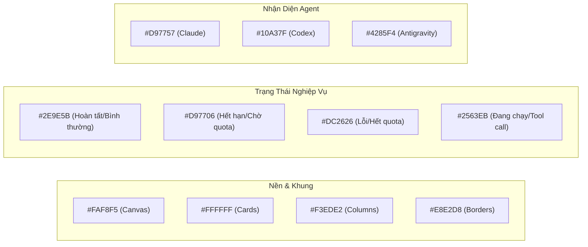

# Quy Chuẩn Thiết Kế UI/UX Cho voragent (DESIGN.md)

Tài liệu này là **nguồn sự thật duy nhất** về toàn bộ nguyên tắc, hệ thống thiết kế (Design System) và checklist đánh giá UI/UX cho voragent — áp dụng xuyên suốt cho cả giao diện Web 2D (Bảng Kanban, Dòng thời gian, Form tác vụ) và Không gian Văn phòng 3D (React Three Fiber).

---

## 1. Triết Lý Thiết Kế Cốt Lõi

Mục tiêu tối thượng: **Người dùng phải hiểu giao diện trong vài giây, hoàn thành công việc dễ dàng và không phải suy nghĩ về cách sử dụng.**

Hệ thống kết hợp hai trường phái:

1. **Công thái học lập trình viên (Developer Ergonomics & Pragmatism):**
   - Đơn giản, độ đặc thông tin cao (high density) nhưng thoáng đãng, tôn trọng thói quen của developer (bàn phím, git diff, terminal logs).
   - Phản hồi tức thì, loại bỏ triệt để các bước thừa.
2. **Không gian ấm áp và sinh động (Warm Cozy Tech):**
   - Màu sắc chủ đạo: Nền cát ấm, bề mặt sáng, viền siêu mảnh, hoàn toàn **không** dùng phong cách u tối hay cyber-neon lạnh lẽo.
   - Tương thích tự nhiên với hình tượng các chú rắn 3D thông minh, tạo cảm giác thân thiện, đáng tin cậy.

---

## 2. Các Nguyên Tắc Thiết Kế Cốt Lõi

### 2.1. Simplicity (Đơn giản hóa)

- **Quy tắc:** Chỉ hiển thị những thông tin và công cụ thực sự cần thiết tại thời điểm người dùng cần.
- **Loại bỏ nhiễu:** Không có 5 nút bấm cùng cấp; mỗi màn hình chỉ có duy nhất 1 Primary Action (ví dụ: `+ Task mới` ở Header, `Gửi phản hồi` ở Task Detail).
- **Tiến trình lũy tiến (Progressive Disclosure):** Các thông số nâng cao (JSON arguments của tool calls, chi tiết git commits dài) mặc định thu gọn, chỉ mở rộng khi người dùng chủ động bấm xem.

### 2.2. Consistency (Tính nhất quán)

Mọi thành phần cùng chức năng phải có cùng hành vi và kiểu hiển thị:

| Thành phần | Quy tắc nhất quán |
| :--- | :--- |
| **Primary Button** | Màu nâu đen đậm chủ đạo (`#1F1B18`), chữ trắng, font-weight 500 |
| **Secondary Button** | Nền trắng, viền mảnh `#E8E2D8`, chữ `#1F1B18` |
| **Danger / Retry Button** | Nền đỏ nhạt (`#FEE2E2`), viền `#FCA5A5`, chữ đỏ `#B91C1C` |
| **Inputs & Selects** | Cùng chiều cao 38px, padding 8px 12px, border-radius 6px, focus-ring xanh |
| **Status Badges** | Hình viên thuốc (`rounded-full`), font-size 12px, có màu semantic đồng bộ |
| **Modals / Drawers** | Cùng hiệu ứng trượt, nút đóng luôn ở góc trên bên phải hoặc phím `Esc` |

### 2.3. Visual Hierarchy (Phân cấp thị giác)

Điều hướng mắt người dùng qua các cấp độ ưu tiên:

1. **Cấp 1 — Tiêu đề trang & Tên task:** Cỡ chữ 20–24px, trọng lượng SemiBold (600), màu đậm nhất `#1F1B18`.
2. **Cấp 2 — Trạng thái hiện hành & Quota:** Màu semantic nổi bật (Xanh lá, Hổ phách, Đỏ).
3. **Cấp 3 — Hành động chính (Primary Action):** Nút bấm có độ tương phản cao nhất.
4. **Cấp 4 — Nội dung chi tiết (Body/Chat):** Cỡ chữ 14px, line-height 1.6, màu `#2B2622`.
5. **Cấp 5 — Thông tin thứ cấp (Metadata, timestamps, path):** Cỡ chữ 12–13px, font monospace, màu `#6E655C`.

### 2.4. Familiarity (Sự quen thuộc — Định luật Jakob)

- Không sáng tạo lại những quy ước đã ăn sâu vào tiềm thức người dùng:
  - Logo và tên hệ thống nằm ở góc trên bên trái, bấm vào để về màn hình chính.
  - Nút thêm mới luôn ở góc trên bên phải.
  - Phím tắt chuẩn: `Esc` để hủy/đóng, `Ctrl + Enter` để gửi tin nhắn.
  - Cấu trúc Kanban 5 cột kinh điển: `Chờ` → `Đang chạy` → `Chờ bạn` → `Xong` → `Lỗi`.

### 2.5. Feedback (Phản hồi tương tác)

Mọi hành vi đều phải có phản hồi tức thì:

| Hành động của người dùng | Phản hồi hệ thống |
| :--- | :--- |
| **Rê chuột (Hover)** | Đổi màu nền nhẹ, nâng nhẹ thẻ (`transform: translateY(-2px)`), tăng bóng |
| **Bấm nút / Gửi lệnh** | Chuyển ngay trạng thái loading / disabled, hiển thị text "Đang khởi tạo…" |
| **Lệnh thành công** | Cập nhật UI ngay lập tức qua WebSocket, chuyển trạng thái cột |
| **Thất bại / Hết Quota** | Hiển thị dải banner lỗi rõ nguyên nhân, dải phân cách bàn giao (Handoff) |
| **Mất kết nối Daemon** | Đèn tín hiệu chuyển đỏ, hiển thị thông báo offline và tự động kết nối lại |

### 2.6. Affordance (Khả năng nhận biết cách sử dụng)

- Nút bấm (Button) phải trông nổi khối hoặc có viền rõ ràng, có hiệu ứng `cursor: pointer`.
- Vùng nhập liệu (Input/Textarea) phải có viền và nền phân biệt rõ so với nền canvas.
- Các mục có thể tương tác (Thẻ task) phải có phản hồi thị giác khi hover để người dùng biết là bấm được.

### 2.7. Accessibility (Khả năng tiếp cận — Chuẩn WCAG 2.2)

- **Độ tương phản (Contrast Ratio):** Văn bản chính đạt tối thiểu 7:1 (chuẩn AAA), văn bản phụ đạt tối thiểu 4.5:1 (chuẩn AA).
- **Không dùng màu sắc làm tín hiệu duy nhất:** Trạng thái lỗi không chỉ dùng màu đỏ mà kèm biểu tượng `✕` hoặc chữ `Lỗi`; trạng thái cảnh báo kèm icon `⚠️`.
- **Hỗ trợ bàn phím:** Focus state rõ ràng với outline ring xanh dương `0 0 0 3px rgba(37,99,235,0.15)`.

### 2.8. Responsive Design (Tương thích màn hình)

- **Desktop lớn (> 1200px):** Kanban 5 cột đầy đủ, bảng quota dàn ngang thoáng.
- **Laptop / Tablet (768px – 1199px):** Kanban chuyển sang lưới 3 cột hoặc cuộn ngang mượt mà, Drawer chi tiết chiếm 50% màn hình.
- **Mobile (< 768px):** Kanban chuyển thành dạng accordion hoặc danh sách xếp dọc, Drawer chiếm toàn màn hình, menu chuyển sang compact.

### 2.9. Tối Ưu Tầm Mắt & Tránh Bắt Người Dùng Cuộn Trang Nhiều (Zero Excessive Scrolling)

- **Nguyên tắc:** Tránh bắt người dùng phải cuộn chuột dài đằng đẵng để tìm kiếm thông tin hoặc bấm nút hành động.
- **Sticky Top Global Navigation (Cố định thanh điều hướng toàn cục):** Toàn bộ cụm Header (Logo, Trạng thái kết nối, Nút `+ Task mới`), Thanh Quota Bar và Bộ chuyển Tab 4 chế độ xem (`.sticky-top-header`) **BẮT BUỘC** phải được ghim cố định ở đầu trang (`position: sticky; top: 0; z-index: 40;`) với hiệu ứng kính mờ ấm (`backdrop-filter: blur(14px)`). Khi danh sách dự án hoặc bảng Kanban kéo dài, người dùng luôn quan sát được Quota nền tảng, có thể chuyển chế độ xem hoặc tạo task mới ngay lập tức mà không phải cuộn ngược lên đỉnh trang.
- **Sticky Bottom Action Dock (Cố định dock hành động chi tiết task):** Tại màn hình `TaskView`, ô nhập tin nhắn và nút `Gửi phản hồi <kbd>Ctrl+↵</kbd>` luôn được ghim cố định ở đáy màn hình (`position: sticky; bottom: 0;`). Dù nhật ký hội thoại có hàng trăm tin nhắn hay Git diff dài hàng nghìn dòng, người dùng luôn có thể phản hồi cho agent ngay tức khắc.
- **Sticky Contextual Toolbars (Cố định thanh công cụ ngữ cảnh):** Các thanh công cụ như ô lọc tìm kiếm và nút làm mới danh sách dự án (`.projects-toolbar`) được giữ cố định ngay dưới thanh tab điều hướng khi cuộn danh sách.
- **Phân trang / Tải lũy tiến (Pagination / Virtualized List):** Khi danh sách dài, kết hợp cuộn nội bộ trong container giới hạn chiều cao hợp lý (`max-height` cố định), tuyệt đối không để trang web dài ngoằng làm trôi mất các công cụ điều khiển.

### 2.10. Tận Dụng Tối Đa Không Gian Màn Hình (Screen Real-Estate Optimization)

- **Nguyên tắc:** Tối ưu hóa từng pixel, triệt tiêu các khoảng trống dư thừa (excessive whitespace) gây lãng phí diện tích hiển thị.
- **Single-Row Compact Command Bar (Hợp nhất thanh điều khiển một hàng duy nhất):**
  - Tuyệt đối không xếp chồng 3–4 tầng menu và banner gây chiếm dụng chiều dọc màn hình (Vertical Screen Tax).
  - Tích hợp toàn bộ: Logo nhận diện, Trạng thái kết nối, Bộ chuyển 4 Tab chế độ xem, Giám sát hạn mức Quota Bar và Nút tạo task `+ Task mới` lên **cùng một hàng ngang duy nhất (Single-Row Bar)** với chiều cao chuẩn ≤ 56px.
  - Tiết kiệm hơn 100px chiều dọc, ưu tiên tối đa tầm nhìn cho nội dung cốt lõi: Bảng Kanban, Danh sách dự án, Transcript và Git Diff.
- **Thích ứng màn hình nhỏ:** Rất nhiều developer làm việc trên laptop màn hình nhỏ (13–14 inch) hoặc chia đôi màn hình (split-screen half width). Do đó:
  - Bố cục phải gọn gàng, độ đặc thông tin hợp lý (compact & dense nhưng thoáng mắt).
  - Không chừa padding/margin quá rộng (> 24px ở các panel phụ) làm hẹp vùng hiển thị nội dung chính.
  - Tận dụng chiều ngang và chiều dọc linh hoạt, ưu tiên tối đa diện tích cho dữ liệu hữu ích: Bảng Kanban, cây thư mục dự án, Git Diff và Terminal Logs.

### 2.11. Thiết Kế Điều Hướng Liền Mạch (Seamless Navigation - Chống Anti-pattern "Box-in-a-Box")

- **Nguyên tắc:** Tránh tuyệt đối bọc khối lồng khối liên tiếp (ví dụ: thanh header bọc container tab bo viền sẫm, bên trong tab active lại bọc một block nổi màu trắng có đổ bóng). Điều này gây cảm giác vụn vặt, chia cắt và làm giao diện nặng nề, thiếu tính chuyên nghiệp.
- **Thanh tab điều hướng phẳng (Flat Seamless Tabs):**
  - Khung bao `.view-tabs` hoàn toàn trong suốt (`background: transparent; border: none; box-shadow: none;`), các tab đứng tự nhiên trên bề mặt Header bar.
  - Tab inactive: Chữ màu dịu (`var(--text-secondary)`), rê chuột vào hiện nền hover mờ siêu nhẹ `rgba(31, 27, 24, 0.05)` với bo góc `6px`.
  - Tab active: Sử dụng nền xám ấm phẳng nhẹ nhàng (`background: rgba(31, 27, 24, 0.08)`), chữ đậm `var(--text-primary)`, không đổ bóng cộm, không viền dày, tạo cảm giác thanh thoát và liền lạc (phong cách Linear / GitHub / Vercel).
- **Đồng bộ hóa các thành phần phụ cận:** Badge trạng thái kết nối (`.status-pill`) và vạch phân cách (`.header-divider`) được tinh giản phẳng mỏng, đảm bảo thanh Header là một dải điều hướng thống nhất, mượt mà từ trái sang phải.

### 2.12. Định Tuyến URL Trực Quan & Bảo Toàn Trạng Thái (Semantic Path + Query & Reload Persistence)

- **Nguyên tắc:** Trải nghiệm điều hướng web hiện đại cần URL trong sáng, tường minh và bền vững. Tuyệt đối không dùng URL hash (`#/...`) gây kỳ dị và thô kệch.
- **Cấu trúc URL chuẩn hóa:**
  - Trang danh sách dự án: `/` hoặc `/projects`
  - Bảng task Kanban toàn thể: `/board`
  - Bảng task theo dự án: `/board?project=<encoded_path>` (ví dụ: `/board?project=D%3A%2FProjects%2Fvoragent`)
  - Không gian Văn phòng 3D: `/office`
  - Đồ thị quan hệ: `/graph`
  - Tạo task mới: `/new` (hoặc `/new?project=<encoded_path>` nếu tạo từ ngữ cảnh dự án)
  - Xem chi tiết task: `/task/<id>` (ví dụ: `/task/task-2026-11-05-001`)
- **Bảo toàn trạng thái khi Reload (Reload Persistence):**
  - Khi người dùng bấm F5 / Reload ở bất kỳ URL nào, ứng dụng khởi tạo state trực tiếp từ `pathname` và `search params`, đảm bảo người dùng ở nguyên màn hình hiện tại mà không bị văng về trang chủ hay mất dữ liệu đang lọc.
  - Tham số xác thực phiên `key=...` tự động được bảo lưu qua các lượt chuyển trang trong `buildUrl`, giúp việc chia sẻ link nội bộ hoặc mở tab mới không bị lỗi 401.
  - Phía server HTTP daemon tự động fallback mọi sub-path không phải static asset về `index.html`.
  - Tương thích ngược: Tự động chuyển hướng mượt mà các URL hash cũ sang Path + Query mới qua `history.replaceState`.

### 2.13. Hệ Thống Điều Khiển Biểu Mẫu & Thời Gian Trực Quan (Custom Form Controls & Datetime UX)

- **Nguyên tắc:** Tuyệt đối loại bỏ các điều khiển mặc định thô sơ của trình duyệt (Windows classic form controls) làm phá vỡ ngôn ngữ thiết kế **Warm Cozy Tech**.
- **Custom Select Dropdown (`CustomSelect`):**
  - Thay thế toàn bộ `<select>` nguyên bản bằng Dropdown tùy chỉnh cao cấp: trigger bo góc mềm, icon ngữ cảnh, mũi tên xoay mượt mà.
  - Tích hợp tìm kiếm nhanh nội bộ (`searchable`), phân cấp thông tin rõ ràng với tiêu đề, đường dẫn phụ (`sublabel`) và badge trạng thái.
  - Dropdown menu nổi với kính mờ ấm, đổ bóng mịn, đánh dấu lựa chọn đang chọn bằng biểu tượng tích xanh `Check`.
- **Custom Multi-Select & Priority Selector (`AgentPriorityMultiSelect`):**
  - Cho phép chọn nhiều agent và sắp xếp thứ tự ưu tiên điều phối (`priority order`) trực quan bằng các card tương tác có màu nhận diện riêng (Claude cam đào, Codex ngọc bích, Antigravity xanh dương).
  - Tích hợp thanh đo Quota mini theo thời gian thực và chế độ chuyển đổi linh hoạt giữa "Tự động hoàn toàn (Auto Quota Handoff)" và "Tùy chỉnh mức ưu tiên".
- **Smart Datetime UX (`TimeBadge`):**
  - Hiển thị thời gian cập nhật dưới dạng thời gian tương đối tự nhiên ("Vừa xong", "5 phút trước", "2 giờ trước", "Hôm qua lúc 14:30"), hover vào hiển thị ngày giờ chuẩn xác đầy đủ.
  - Tự động gắn chấm xanh nhấp nháy (`pulse dot`) cho các tác vụ hoạt động trong 15 phút gần nhất.
- **Custom Native Controls & Scrollbar:**
  - Thanh cuộn (`::-webkit-scrollbar`): Siêu mỏng 6px, bo tròn `radius-full`, màu ấm mờ `rgba(31, 27, 24, 0.18)` không xâm lấn nội dung.
  - Native `<select>` fallback: Tự động thay mũi tên đen mặc định của hệ điều hành bằng inline SVG chevron sắc nét.
  - Custom checkbox: Bo góc 4px với SVG checkmark, không dùng ô vuông xám Windows.
  - Warm focus ring: Thay viền xanh công nghiệp bằng viền ấm công nghệ `rgba(217, 119, 87, 0.18)`.

### 2.14. Quy Chuẩn Triệt Tiêu Thanh Cuộn Lồng Nhau (Zero Double Scrollbars Architecture)

- **Nguyên tắc "Đơn Thanh Cuộn" (Single Active Scrollbar):** Trong mọi màn hình, trên cùng một chiều không gian (dọc hoặc ngang), **TUYỆT ĐỐI CHỈ TỒN TẠI TỐI ĐA 1 THANH CUỘN HOẠT ĐỘNG**. Nghiêm cấm đặt thanh cuộn của cửa sổ trình duyệt (`window` / `body`) và thanh cuộn của container con (`overflow-y: auto`) nằm song song, gây giật cục chuột và rối mắt người dùng.
- **Màn hình danh sách mở rộng (Unified Page Scroll):**
  - Màn hình dạng danh sách dài (như `ProjectList`): Tuyệt đối không áp đặt `max-height: calc(100vh - Xpx)` và `overflow-y: auto` lên container con.
  - Cho phép danh sách chảy tự nhiên trên toàn trang với đúng 1 thanh cuộn duy nhất ở mép ngoài cùng của trình duyệt.
  - **Sticky Contextual Toolbars:** Khi cuộn danh sách dài, thanh tìm kiếm và nút thao tác (`.projects-toolbar`) bám dính thông minh ngay bên dưới Top Header bar (`position: sticky; top: 52px; z-index: 30;` với nền mờ `backdrop-filter: blur(10px)`), đảm bảo các nút điều khiển luôn sẵn sàng mà không cần cuộn ngược lên đỉnh.
- **Màn hình chuyên biệt dạng App Shell (Kanban, 3D Canvas, Split-Screen):**
  - Giữ cố định chiều cao vừa khít 100% viewport, triệt tiêu hoàn toàn thanh cuộn thừa ngoài cửa sổ.
  - Chỉ cho phép cuộn nội bộ độc lập trong từng phân vùng riêng biệt (từng cột Kanban `.column-body`, cột hội thoại Transcript `.transcript`, hoặc Diff viewer).

---

## 3. Hệ Thống Bố Cục (Layout & Spacing System)

Sử dụng thang đo khoảng cách chuẩn dựa trên bội số của 4px:

| Token | Giá trị | Ứng dụng thực tế |
| :--- | :--- | :--- |
| **`space-2xs`** | 4px | Khoảng cách icon và chữ, padding chip siêu nhỏ |
| **`space-xs`** | 8px | Khoảng cách giữa các badge, khoảng cách dòng metadata |
| **`space-sm`** | 12px | Padding trong card nhỏ, padding ô input |
| **`space-md`** | 16px | Padding chuẩn của panel, khoảng cách giữa các khối |
| **`space-lg`** | 24px | Khoảng cách giữa các cột Kanban, lề section |
| **`space-xl`** | 32px | Khoảng cách giữa Header và Content, khoảng cách nhóm lớn |
| **`space-2xl`** | 48px | Padding các khối rỗng (Empty state), placeholder |
| **`space-3xl`** | 64px | Khoảng trống phân trang lớn |

---

## 4. Hệ Thống Typography (Kiểu Chữ)

Sử dụng hệ thống phông kép (Dual-Font System):

- **Phông giao diện:** `Inter`, `Geist`, hoặc hệ thống sans-serif hiện đại.
- **Phông kỹ thuật (Code, Git, Logs, Path):** `JetBrains Mono` hoặc `Fira Code`.

| Cấp bậc | Kích thước | Chiều cao dòng (line-height) | Trọng lượng (weight) | Mục đích |
| :--- | :--- | :--- | :--- | :--- |
| **Page Heading** | 24–28px | 1.25 | Bold (700) | Tên ứng dụng, tiêu đề màn hình lớn |
| **Section Heading** | 18–20px | 1.3 | SemiBold (600) | Tiêu đề Task Detail, tiêu đề Form |
| **Card / Subheading** | 14–16px | 1.4 | SemiBold (600) | Tiêu đề thẻ Task trên Kanban |
| **Body Text** | 14px | 1.6 | Regular (400) | Lời thoại agent, văn bản chat, mô tả |
| **Caption / Meta** | 12–13px | 1.4 | Medium (500) | Nhãn phụ, thời gian, tên git branch |
| **Code / Logs** | 13px | 1.6 | Regular (400) | Lệnh terminal, diffs, JSON args |

---

## 5. Hệ Thống Màu Sắc & Tokens (Color System)

### Chi tiết các mã màu chuẩn

- **Canvas Background:** `#FAF8F5` (Màu cát nhạt, dịu mắt hơn màu trắng gắt).
- **Surface / Card Background:** `#FFFFFF` (Bề mặt thẻ, bảng điều khiển).
- **Column / Group Background:** `#F3EDE2` (Nền cột Kanban, nền tab switcher).
- **Subtle Border:** `#E8E2D8` (Viền phân cách 1px).
- **Text Primary:** `#1F1B18` (Màu chữ đen ấm, tương phản cao).
- **Text Secondary:** `#6E655C` (Màu chữ phụ, mô tả, nhãn).
- **Semantic Green (Success/Ready):** Nền `#EAF6EE`, viền `#A3DCB7`, chữ `#1C7441`.
- **Semantic Amber (Warning/Cooldown):** Nền `#FEF3C7`, viền `#FCD34D`, chữ `#92400E`.
- **Semantic Red (Error/Quota Exhausted):** Nền `#FEE2E2`, viền `#FCA5A5`, chữ `#B91C1C`.
- **Semantic Blue (Info/Running):** Nền `#EFF6FF`, viền `#BFDBFE`, chữ `#1D4ED8`.

---

## 6. Trải Nghiệm Tương Tác & Tâm Lý Học UX

Áp dụng các định luật UX kinh điển vào thiết kế của voragent:

1. **Định luật Hick (Hick's Law):**
   - Giảm thiểu số lượng lựa chọn cùng một lúc. Khi tạo task, chỉ cần nhập Repo Path và Tin nhắn là có thể khởi chạy ngay với chế độ mặc định tối ưu nhất (`head-dirty-commit` và tự động chọn provider).
2. **Định luật Fitts (Fitts's Law):**
   - Nút hành động chính (`Gửi phản hồi`, `Tạo task`) có kích thước đủ lớn (chiều cao ≥ 38px), đặt ở vị trí thuận tầm tay.
3. **Định luật Miller (Miller's Law):**
   - Chia thông tin thành các cụm nhỏ (Chunking): Một thẻ task được chia rõ 3 phần: Đầu thẻ (`#seq` + Agent), Thân thẻ (Tiêu đề + Repo), Chân thẻ (Trạng thái + Số lần bàn giao).
4. **Ngưỡng Doherty (Doherty Threshold):**
   - Phản hồi dưới 400ms. Khi người dùng bấm nút, giao diện hiển thị trạng thái đang xử lý ngay lập tức, không để màn hình đơ không phản ứng.
5. **Giảm thiểu nỗ lực người dùng (Minimize User Effort):**
   - Không bắt người dùng gõ lại đường dẫn repo nếu đã từng nhập; ghi nhớ cấu hình ưu tiên.
6. **Ngăn ngừa & Khôi phục lỗi (Error Prevention & Recovery):**
   - Cảnh báo rõ ràng màu hổ phách khi thư mục làm việc không phải repo git (`⚠️ Không cách ly`).
   - Cung cấp nút `Thử lại` và nút `Chuyển nền tảng khác` ngay tại task bị lỗi để khôi phục chỉ với 1 click.

---

## 7. Các Trạng Thái UI Bắt Buộc (Mandatory Component States)

Mọi component khi hiện thực đều **phải** được thiết kế đầy đủ các trạng thái sau trước khi coi là hoàn thành:

| Trạng thái | Yêu cầu hiển thị trong voragent |
| :--- | :--- |
| **1. Default** | Hiển thị chuẩn, màu sắc hài hòa theo token |
| **2. Hover** | Đổi màu nền nhẹ, nâng nhẹ thẻ (`translateY(-2px)`), đổi con trỏ chuột |
| **3. Focus** | Xuất hiện focus-ring xanh dương rõ ràng khi di chuyển bằng phím Tab |
| **4. Active** | Hiệu ứng lún nhẹ khi click chuột xuống |
| **5. Disabled** | Giảm opacity xuống 50%, con trỏ `not-allowed`, vô hiệu hóa sự kiện click |
| **6. Loading** | Nút bấm hiện chữ "Đang xử lý…", danh sách hiện spinner hoặc pulse |
| **7. Success** | Huy hiệu xanh lá, thông báo hoàn tất mượt mà |
| **8. Error** | Khung đỏ viền nổi, câu thông báo lỗi bằng tiếng Việt rõ ràng, kèm cách khắc phục |
| **9. Empty State** | Khi cột Kanban hoặc danh sách trống: hiển thị hình minh họa nhẹ kèm câu hướng dẫn thân thiện |
| **10. Skeleton** | Khi dữ liệu đang tải lần đầu: hiển thị khung xương mờ thay vì để màn hình trắng |

---

## 8. Kết Nối Thẩm Mỹ Với Văn Phòng 3D (Giai đoạn 2)

Không gian 3D và giao diện 2D là một thực thể thống nhất:

- **Tông màu đồng điệu:** Sàn văn phòng 3D mang tông gỗ thông ấm áp, tường màu cát nhạt tương đồng màu nền `#FAF8F5` của web.
- **Nhân vật Chú Rắn:** Mỗi chú rắn trong 3D mang dải vằn màu nhận diện của provider (Claude cam, Codex ngọc, AGY xanh), tương ứng với avatar 2D trên thẻ task.
- **Hoạt cảnh Handoff:** Khi hết quota, trên 2D xuất hiện dải phân cách bàn giao (Handoff Divider), đồng thời trong 3D chú rắn cũ trườn về khu nghỉ và chú rắn mới trườn ra bàn làm việc.

---

## 9. Thứ Tự Ưu Tiên Triển Khai Cho Developer

Khi lập trình bất kỳ màn hình nào, tuân thủ đúng thứ tự ưu tiên:

1. **Ưu tiên 1:** Đảm bảo người dùng hiểu giao diện ngay lập tức.
2. **Ưu tiên 2:** Đảm bảo hoàn thành được mục tiêu (tạo task, xem diff, gửi prompt tiếp theo).
3. **Ưu tiên 3:** Tối ưu giảm thiểu thao tác bấm thừa.
4. **Ưu tiên 4:** Xây dựng bố cục (Layout), căn chỉnh (Alignment) và phân cấp thị giác (Hierarchy).
5. **Ưu tiên 5:** Chuẩn hóa Design System và Spacing tokens.
6. **Ưu tiên 6:** Hoàn thiện đủ 10 trạng thái component (Loading, Error, Empty...).
7. **Ưu tiên 7:** Tương thích màn hình (Responsive) và khả năng tiếp cận (Accessibility).
8. **Ưu tiên 8:** Tinh chỉnh chuyển động (Animation) và hiệu ứng thị giác.

---

## 10. Checklist Đánh Giá UI/UX Trước Khi Phát Hành

Sử dụng bảng kiểm tra này trước khi merge bất kỳ thay đổi UI nào vào `main`:

### Bố cục & Phân cấp (Layout & Hierarchy)

- [ ] Bố cục rõ ràng, đúng thang đo khoảng cách (bội số 4px).
- [ ] Không có hiện tượng dồn cục hay nhồi nhét nội dung.
- [ ] Căn chỉnh thẳng hàng theo trục thị giác.
- [ ] Tiêu đề và hành động chính nổi bật nhất trong 3 giây đầu tiên quan sát.
- [ ] Tận dụng tối đa diện tích màn hình, không có khoảng trống lãng phí, hiển thị tối ưu trên màn hình nhỏ hoặc cửa sổ chia đôi.

### Kiểu chữ & Màu sắc (Typography & Color)

- [ ] Sử dụng đúng phông Sans cho UI và Monospace cho mã nguồn, git diff, path.
- [ ] Đạt chuẩn tương phản chữ WCAG AA (chữ dễ đọc trên nền cát).
- [ ] Màu semantic (Xanh, Hổ phách, Đỏ) được dùng đúng vai trò, không lạm dụng màu rực rỡ.

### Tương tác & Phản hồi (Interaction & Feedback)

- [ ] Button có đủ hiệu ứng Hover, Active, Disabled, Loading.
- [ ] Mọi hành động bất đồng bộ đều có phản hồi thị giác rõ ràng.
- [ ] Có Empty State khi chưa có task nào trong hàng đợi hoặc cột.
- [ ] Lỗi được giải thích bằng tiếng Việt kèm nút bấm khôi phục (Retry).
- [ ] Không bắt người dùng cuộn trang quá dài; phân trang/cuộn nội bộ hợp lý; các nút hành động chính (gửi, tạo, duyệt) được sticky/float thuận tiện thao tác.

### Khả năng tiếp cận & Thiết bị (Accessibility & Responsive)

- [ ] Di chuyển và tương tác được bằng bàn phím (Tab, Enter, Esc).
- [ ] Hiển thị tốt trên cả màn hình nhỏ (Laptop, Tablet) không bị vỡ layout hoặc tràn viền ngang ngoài ý muốn.
- [ ] Dữ liệu quan trọng không chỉ dựa vào màu sắc mà có nhãn/biểu tượng đi kèm.
