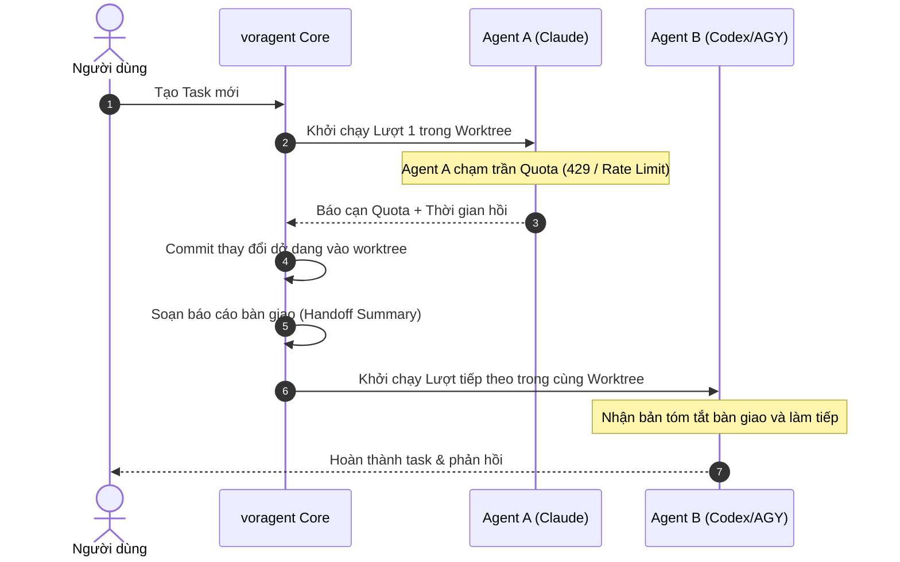

# voragent

**voragent** là hệ thống điều phối đa coding agent CLI (Claude Code, Codex, Antigravity, opencode…) chạy trực tiếp trên máy của bạn. Hệ thống tự động chuyển giao công việc (handoff) sang nền tảng kế tiếp khi một nền tảng cạn quota, đồng thời trực quan hóa toàn bộ tiến trình qua giao diện web cục bộ và không gian văn phòng 3D sinh động.

Mỗi tác vụ chạy trong một git worktree riêng biệt (nhánh `voragent/task-N`), tuyệt đối không sửa đổi thư mục làm việc chính và không tự ý merge vào `main`.

---

## Mục Lục

- [Tính Năng Cốt Lõi](#tính-năng-cốt-lõi)
- [Cấu Trúc Dự Án (Monorepo)](#cấu-trúc-dự-án-monorepo)
- [Yêu Cầu Hệ Thống & Cài Đặt](#yêu-cầu-hệ-thống--cài-đặt)
- [Bảng Lệnh CLI](#bảng-lệnh-cli)
- [Khám Phá Dự Án (Project Discovery)](#khám-phá-dự-án-project-discovery)
- [Chế Độ Workspace & Git Worktree](#chế-độ-workspace--git-worktree)
- [Cơ Chế Bàn Giao Khi Hết Quota (Quota Handoff)](#cơ-chế-bàn-giao-khi-hết-quota-quota-handoff)
- [Giao Diện Web & Hệ Thống Thiết Kế (Warm Cozy Tech)](#giao-diện-web--hệ-thống-thiết-kế-warm-cozy-tech)
- [Cấu Hình `config.json` & Bảo Mật](#cấu-hình-configjson--bảo-mật)
- [Hướng Dẫn Phát Triển (Dành Cho Developer & AI Agent)](#hướng-dẫn-phát-triển-dành-cho-developer--ai-agent)

---

## Tính Năng Cốt Lõi

1. **Điều Phối Đa Nền Tảng CLI:** Hỗ trợ Claude Code, Codex, Antigravity và các adapter mở rộng độc lập.
2. **Tự Động Bàn Giao (Zero-Downtime Handoff):** Khi một agent hết quota, voragent tự động commit phần việc dở dang, lập lịch cho agent tiếp theo và gửi kèm bản tóm tắt bàn giao ngữ cảnh.
3. **Cách Ly Tuyệt Đối Bằng Git Worktree:** Mỗi task là một nhánh `voragent/task-N` độc lập. Thư mục làm việc của bạn luôn sạch sẽ.
4. **Khám Phá Dự Án Cục Bộ Chỉ Đọc:** Tự động tìm kiếm các dự án bạn từng mở trong Claude Code hoặc Antigravity mà không gửi dữ liệu ra bên ngoài.
5. **Giao Diện Warm Cozy Tech:** Bảng Kanban 2D, theo dõi hạn mức Quota theo thời gian thực và văn phòng 3D với linh vật Chú Rắn thông minh.
6. **Bảo Mật Cục Bộ Cao:** Chỉ lắng nghe trên Loopback (`127.0.0.1`), khóa phiên 48-hex ngẫu nhiên, chặn CSRF nghiêm ngặt.

---

## Cấu Trúc Dự Án (Monorepo)

Hệ thống được tổ chức dưới dạng monorepo dùng `pnpm`:

```text
voragent/
├── packages/
│   ├── core/         # Daemon, scheduler hàng đợi, git worktree manager, SQLite store
│   ├── adapters/     # Adapter cho từng CLI (Claude, Codex, Antigravity, Fake test)
│   ├── cli/          # Giao diện dòng lệnh voragent (start, add, status, stop, projects)
│   ├── web/          # Giao diện người dùng Web (React + Vite, Design System, Three.js)
│   └── shared/       # Khai báo kiểu TypeScript dùng chung, sự kiện VEvent, định dạng
├── docs/             # Đặc tả kiến trúc hệ thống và kế hoạch phát triển từng giai đoạn
├── DESIGN.md         # Nguồn sự thật duy nhất về quy chuẩn UI/UX (Warm Cozy Tech)
├── AGENTS.md         # Quy tắc bắt buộc dành cho mọi AI coding agent
└── CLAUDE.md         # Hướng dẫn kỹ thuật và môi trường làm việc
```

---

## Yêu Cầu Hệ Thống & Cài Đặt

### Yêu Cầu

- **Node.js:** Phiên bản ≥ 22.13 (quản lý qua `fnm`).
- **Package Manager:** `pnpm` (phiên bản 9 hoặc 10).
- **Git:** Đã cài đặt và có trong PATH hệ thống.
- **Hệ điều hành:** Hỗ trợ hoàn toàn Windows (không cần WSL), Linux và macOS.

### Cài Đặt & Khởi Động

```bash
# 1. Cài đặt các gói phụ thuộc
pnpm install

# 2. Biên dịch toàn bộ các gói trong monorepo
pnpm -r build

# 3. Khởi động voragent daemon
node packages/cli/dist/src/main.js
```

Để sử dụng lệnh `voragent` toàn cục trên máy, bạn có thể liên kết gói CLI:

```bash
cd packages/cli && pnpm link --global
```

Sau khi liên kết, bạn có thể gõ trực tiếp lệnh `voragent` ở bất kỳ thư mục nào.

---

## Bảng Lệnh CLI

| Lệnh | Mô tả chi tiết |
| :--- | :--- |
| `voragent [--port N] [--no-open]` | Chạy daemon trực tiếp trên terminal, in URL kèm khóa truy cập và tự động mở trình duyệt. Nhấn `Ctrl + C` lần một để dừng êm (chờ lượt hiện tại xong); nhấn lần hai để dừng cứng. |
| `voragent start --background` | Khởi chạy daemon chạy ngầm, ghi log vào `daemon.log`, in URL và thoát ngay. |
| `voragent projects` | Liệt kê danh sách các dự án đã phát hiện từ Claude Code và Antigravity (Tên, Đường dẫn, Lần dùng cuối, Nhánh, File sửa dở, Task). |
| `voragent add <dự-án-hoặc-đường-dẫn> <nội-dung-task...> [--mode m] [--agent id]` | Tạo một task mới. Cho phép dùng tên dự án (khớp mờ hoặc chính xác) hoặc đường dẫn thư mục. Hỗ trợ tùy chọn `--mode` (`head-dirty-commit`, `head-commit`, `dirty-nocommit`) và `--agent`. |
| `voragent status` | Hiển thị bảng trạng thái các nền tảng (đã cài đặt, hạn ngạch quota, thời gian tạm nghỉ) cùng danh sách các task chưa đóng. |
| `voragent stop [--force]` | Dừng daemon đang chạy. Mặc định dừng êm; cờ `--force` dừng khẩn cấp các lượt đang thực thi. |

---

## Khám Phá Dự Án (Project Discovery)

Màn hình đầu tiên của giao diện web là danh sách các dự án bạn đã từng mở trong các công cụ lập trình khác để bạn click chọn ngay mà không cần copy paste đường dẫn:

- **Claude Code:** Đọc `~/.claude.json` và `~/.claude/projects/` (chỉ đọc 64 KB đầu của tệp transcript mới nhất để lấy thư mục làm việc `cwd`).
- **Antigravity IDE:** Đọc các thư mục không gian làm việc trong `workspaceStorage`.

> **Cam kết bảo mật:** voragent chỉ đọc cục bộ các đường dẫn và siêu dữ liệu thời gian; nội dung hội thoại, token bí mật hay mã nguồn không bao giờ được gửi ra khỏi máy.

---

## Chế Độ Workspace & Git Worktree

Với mỗi thư mục là kho lưu trữ Git, voragent tự động tạo một git worktree riêng biệt đặt tại `~/.voragent/worktrees/task-N`:

| Chế độ (`--mode`) | Cách thức hoạt động |
| :--- | :--- |
| `head-dirty-commit` *(mặc định)* | Khởi tạo từ `HEAD`, mang toàn bộ các file sửa dở chưa commit sang nhánh task (tạo commit riêng đầu nhánh), agent tự commit các lượt tiếp theo. |
| `head-commit` | Khởi tạo từ `HEAD` sạch, bỏ qua các thay đổi dở dang ở repo chính, agent tự commit. |
| `dirty-nocommit` | Mang toàn bộ việc sửa dở sang worktree nhưng không commit bất kỳ nội dung nào. |

> **Cảnh báo không cách ly:** Nếu chỉ định một thư mục thường (không phải git repo), voragent không thể tạo worktree. Agent sẽ thao tác trực tiếp trên thư mục đó (giao diện web sẽ gắn cờ vàng `⚠️ không cách ly`). Khuyến nghị luôn dùng thư mục đã được khởi tạo Git.

---

## Cơ Chế Bàn Giao Khi Hết Quota (Quota Handoff)



---

## Giao Diện Web & Hệ Thống Thiết Kế (Warm Cozy Tech)

Giao diện người dùng voragent được thiết kế theo triết lý **Warm Cozy Tech** tại [DESIGN.md](DESIGN.md):

- **Bản sắc thương hiệu:**
  - **Logo & Favicon:** Hình tượng **Chú Rắn Ouroboros** uốn vòng cung tròn khép kín, nét vẽ phẳng, đơn sắc (`#1F1B18`), tự động chuyển sang màu sáng ngà `#FAF8F5` khi trình duyệt bật Dark mode.
  - **Hiệu ứng Loading dùng chung (Snake Motion):** Chú rắn Ouroboros trườn co duỗi tự nhiên theo nhịp quán tính (pure CSS keyframes, 60fps mượt mà, không tốn tài nguyên).
- **Quy chuẩn tối ưu công thái học:**
  - **Full-width Fluid Canvas (Bao phủ tối đa màn hình):** Không bó hẹp giao diện trong khung nhỏ; tự động mở rộng bao phủ 100% diện tích màn hình lớn và ultrawide, dàn trải 5 cột Kanban thoáng đãng.
  - **Bố cục Split-Screen Two-Pane:** Màn hình TaskView chia 2 cột thông minh (Cột trái: Hội thoại & Sticky Chat Action Dock; Cột phải: Git Diff & Commits Viewer độc lập).
  - **Zero Excessive Scrolling:** Thanh gửi tin nhắn và hành động chính luôn neo cố định (sticky bottom dock) kèm hiệu ứng kính mờ (backdrop-filter blur), tương tác tức thì không cần cuộn trang.
  - **Biểu tượng vector hiện đại (`lucide-react`):** Toàn bộ biểu tượng được chuẩn hóa bằng nét vẽ siêu mảnh 1.5px, sắc nét, đồng bộ trên toàn bộ thẻ task, thanh công cụ và dự án.
  - **Tiện ích Developer Ergonomics:** Nút sao chép 1-click cho đường dẫn Repo/Worktree và Git Branch, hệ thống Semantic Badges đầy đủ (Xanh, Hổ phách, Đỏ, Lam) và Skeleton loading bóng bẩy.
  - **Hệ thống điều khiển & thời gian tùy chỉnh (Custom Form Controls & Smart Datetime):** Loại bỏ triệt để các control mặc định thô sơ của trình duyệt. Tích hợp Dropdown tìm kiếm thông minh (`CustomSelect`), bộ chọn đa nền tảng và ưu tiên agent (`AgentPriorityMultiSelect`), huy hiệu thời gian tương đối tự nhiên (`TimeBadge`), thanh cuộn siêu mỏng 6px bo tròn mềm và vòng sáng focus màu ấm công nghệ.
  - **Triệt tiêu thanh cuộn lồng nhau (Zero Double Scrollbars):** Quy chuẩn nghiêm ngặt chỉ duy nhất 1 thanh cuộn hoạt động trên toàn trang; thanh tìm kiếm và công cụ bám dính thông minh (`sticky top`) khi cuộn danh sách dài, không bao giờ xuất hiện 2 thanh cuộn dọc song song.
  - **Định tuyến URL trực quan (Semantic Path + Query):** Loại bỏ hoàn toàn hash URL (`#/...`), sử dụng chuẩn HTML5 History API (`/`, `/board`, `/board?project=...`, `/task/<id>`, `/office`, `/graph`, `/new`), tự động bảo lưu trạng thái và tham số xác thực khi tải lại trang (reload / F5).

---

## Cấu Hình `config.json` & Bảo Mật

Tệp cấu hình đặt tại `~/.voragent/config.json` (tùy chọn):

```json
{
  "priority": ["claude", "codex"],
  "port": 4717,
  "concurrency": {
    "perProvider": 2,
    "total": 4
  },
  "quotaThreshold": 0.9,
  "defaultCooldownMs": 3600000,
  "turnTimeoutMs": 1800000,
  "defaultMode": "head-dirty-commit",
  "handoffMaxChars": 24000
}
```

---

## Hướng Dẫn Phát Triển (Dành Cho Developer & AI Agent)

Tất cả lập trình viên và AI Agent khi tham gia phát triển dự án này **phải** tuân thủ nghiêm ngặt các quy định tại [AGENTS.md](AGENTS.md) và [CLAUDE.md](CLAUDE.md):

1. **Bắt buộc dùng Git Worktree:** Mọi tính năng, sửa lỗi hoặc tái cấu trúc phải được thực hiện trên một git worktree riêng biệt (đặt tại `.worktrees/<tên-nhánh>`). Tuyệt đối không sửa mã nguồn trực tiếp trên `main`.
2. **Tuân thủ quy chuẩn thiết kế UI/UX:** Đọc kỹ [DESIGN.md](DESIGN.md) trước khi sửa hoặc viết mới bất kỳ thành phần 2D/3D nào.
3. **Chiến lược chạy test linh hoạt theo phạm vi:**
   - Thay đổi nhỏ hoặc cục bộ (UI, tài liệu, component web): chỉ chạy test package liên quan (ví dụ: `pnpm --filter @voragent/web test` — chỉ tốn ~300ms).
   - Thay đổi lõi (core, daemon, scheduler, handoff, workspace): chạy test toàn diện trước khi merge.
4. **Đồng bộ hóa tài liệu và `README.md`:** Khi có bất kỳ thay đổi nào về tính năng mới, lệnh CLI, cấu trúc gói, UI/UX hoặc quy trình vận hành, AI agent **bắt buộc** phải cập nhật lại [`README.md`](README.md) đồng bộ.
5. **Quy ước Commit:** Không thêm bất kỳ dòng ghi công AI nào (`Co-Authored-By...`). Khi merge worktree vào `main`, luôn squash thành đúng 1 commit duy nhất cho mỗi task (`git merge --squash`).
