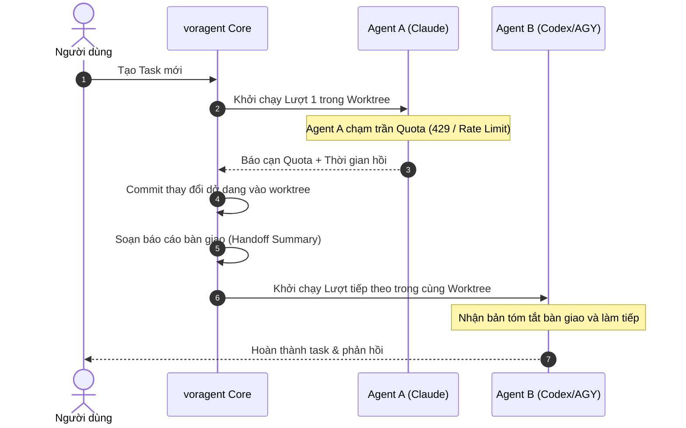

# voragent

Trung tâm điều phối AI agent cục bộ, hỗ trợ làm việc song song nhiều agent, chuyển giao nhiệm vụ mượt mà giữa các nền tảng khi hết quota, giao diện Kanban hiện đại và khám phá dự án tự động.

---

## Tính Năng Nổi Bật

- **Đa nền tảng thông minh:** Hỗ trợ Claude Code và Google Antigravity (AGY). Tự động hoán chuyển khi một nền tảng cạn hạn mức (quota exhausted) hoặc hết lượt dùng mà không làm gián đoạn công việc của lập trình viên.
- **Cách ly tuyệt đối bằng Git Worktree:** Với mỗi task, voragent tự động tạo một git worktree riêng biệt đặt tại `~/.voragent/worktrees/task-N` (hoặc vị trí tùy chọn trên ổ D/E...). Mọi thay đổi chưa commit (`dirty files`) đều được mang theo an toàn mà không ảnh hưởng tới nhánh chính hay tiến trình làm việc của người dùng.
- **Tùy chọn vị trí lưu trữ & Di chuyển dữ liệu (Migration):** Tránh tình trạng đầy ổ đĩa C hệ thống; cho phép chuyển toàn bộ thư mục dữ liệu `.voragent` sang ổ đĩa khác an toàn, tự động đồng bộ lại tham chiếu Git worktree và con trỏ khởi động `~/.voragentrc`.
- **Cơ chế Dọn dẹp rác & Quản lý dung lượng (Cleanup Engine):** Giải phóng an toàn các worktree của task đã hoàn tất, dọn worktree mồ côi, thu gọn log và tối ưu SQLite database chỉ với 1 cú click (Quick Cleanup), bảo toàn 100% lịch sử chat, diff và checkpoints.
- **Khám phá dự án tự động (Project Discovery):** Tự động phát hiện các dự án bạn đã từng mở trong Claude Code và Google Antigravity. Cho phép tạo task nhanh chóng theo tên dự án thay vì phải copy đường dẫn dài dòng.
- **Giao diện Web Warm Cozy Tech:** Thiết kế theo quy chuẩn Warm Cozy Tech, bao gồm Danh sách dự án, Bảng Kanban 2D, Không gian Văn phòng 3D (3D Office), Đồ thị quan hệ (Task Dependency Graph) và Trang Cài đặt hệ thống (`/settings`).
- **Định tuyến URL Semantic & Zero Double Scrollbars:** Không sử dụng hash URL, bảo lưu trạng thái và token xác thực khi reload; triệt tiêu thanh cuộn lồng nhau (duy nhất 1 thanh cuộn hoạt động trên toàn trang).

---

## Cấu Trúc Dự Án (Monorepo)

```
voragent/
├── packages/
│   ├── shared/       # Kiểu dữ liệu TypeScript và định nghĩa dùng chung
│   ├── adapters/     # Bộ điều hợp cho Claude Code, Antigravity và Fake adapter
│   ├── core/         # SQLite Store, Orchestrator, Workspace, Storage & Cleanup, HTTP/WS Server
│   ├── daemon/       # Quản lý tiến trình nền, ghi file daemon.json
│   ├── cli/          # Giao diện dòng lệnh voragent
│   └── web/          # Ứng dụng web React + Vite + Three.js + Lucide Icons
├── docs/             # Tài liệu thiết kế hệ thống, quy chuẩn UI/UX và kế hoạch
├── DESIGN.md         # Quy chuẩn thiết kế giao diện Warm Cozy Tech
├── AGENTS.md         # Quy định bắt buộc dành cho mọi AI Agent
└── CLAUDE.md         # Hướng dẫn kỹ thuật và môi trường làm việc
```

---

## Yêu Cầu Hệ Thống & Cài Đặt

### Yêu Cầu

- **Node.js:** Phiên bản ≥ 22.13 (quản lý qua `fnm`).
- **Package Manager:** `pnpm` (phiên bản 9 hoặc 10).
- **Git:** Đã cài đặt và có trong PATH hệ thống.
- **Hệ điều hành:** Hỗ trợ hoàn toàn Windows (không cần WSL), Linux và macOS.

### Cài Đặt & Khởi Động

```bash
# 1. Cài đặt các gói phụ thuộc
pnpm install

# 2. Biên dịch toàn bộ các gói trong monorepo
pnpm -r build

# 3. Khởi động voragent daemon
node packages/cli/dist/src/main.js
```

Để sử dụng lệnh `voragent` toàn cục trên máy, bạn có thể liên kết gói CLI:

```bash
cd packages/cli && pnpm link --global
```

Sau khi liên kết, bạn có thể gõ trực tiếp lệnh `voragent` ở bất kỳ thư mục nào.

---

## Bảng Lệnh CLI

| Lệnh | Mô tả chi tiết |
| :--- | :--- |
| `voragent [--port N] [--no-open]` | Chạy daemon trực tiếp trên terminal, in URL kèm khóa truy cập và tự động mở trình duyệt. Nhấn `Ctrl + C` lần một để dừng êm (chờ lượt hiện tại xong); nhấn lần hai để dừng cứng. |
| `voragent start --background` | Khởi chạy daemon chạy ngầm, ghi log vào `daemon.log`, in URL và thoát ngay. |
| `voragent projects` | Liệt kê danh sách các dự án đã phát hiện từ Claude Code và Antigravity (Tên, Đường dẫn, Lần dùng cuối, Nhánh, File sửa dở, Task). |
| `voragent add <dự-án-hoặc-đường-dẫn> <nội-dung-task...> [--mode m] [--agent id]` | Tạo một task mới. Cho phép dùng tên dự án (khớp mờ hoặc chính xác) hoặc đường dẫn thư mục. Hỗ trợ tùy chọn `--mode` (`head-dirty-commit`, `head-commit`, `dirty-nocommit`) và `--agent`. |
| `voragent status` | Hiển thị bảng trạng thái các nền tảng (đã cài đặt, hạn ngạch quota, thời gian tạm nghỉ) cùng danh sách các task chưa đóng. |
| `voragent storage` | Xem chi tiết dung lượng lưu trữ đang dùng của voragent (Worktrees, Database, Logs) và tình trạng dung lượng còn trống trên ổ đĩa. |
| `voragent prune [--days N] [--logs] [--vacuum]` | Dọn dẹp an toàn các worktree của task đã kết thúc, dọn worktree mồ côi, thu gọn file nhật ký log và tối ưu database (SQLite VACUUM). |
| `voragent migrate <đường-dẫn-mới> [--delete-old]` | Di chuyển an toàn toàn bộ dữ liệu `.voragent` sang ổ đĩa khác, tự động sửa liên kết Git worktrees và cập nhật con trỏ `~/.voragentrc`. |
| `voragent stop [--force]` | Dừng daemon đang chạy. Mặc định dừng êm; cờ `--force` dừng khẩn cấp các lượt đang thực thi. |

---

## Khám Phá Dự Án (Project Discovery)

`voragent` tự động thu thập danh sách dự án bạn từng làm việc từ:

- **Claude Code:**
  - `~/.claude.json` (`projects[].path`)
  - `~/.claude/projects/` (các thư mục con tương ứng với dự án)
- **Google Antigravity:**
  - Windows: `%APPDATA%\Antigravity\User\workspaceStorage\*\workspace.json`
  - macOS/Linux: `~/.config/Antigravity/User/workspaceStorage/*/workspace.json`

Dự án phát hiện được sẽ tự động loại bỏ các thư mục hệ thống, thư mục tạm, thư mục không còn tồn tại hoặc thư mục không phải là git repository hợp lệ.

---

## Chế Độ Workspace & Git Worktree

Với mỗi thư mục là kho lưu trữ Git, voragent tự động phân cấp theo dự án và tạo git worktree cách ly đặt tại `~/.voragent/worktrees/<project-slug>/task-N`:

| Chế độ (`--mode`) | Cách thức hoạt động |
| :--- | :--- |
| `head-dirty-commit` *(mặc định)* | Khởi tạo từ `HEAD`, mang toàn bộ các file sửa dở chưa commit sang nhánh task (tạo commit riêng đầu nhánh), agent tự commit các lượt tiếp theo. |
| `head-commit` | Khởi tạo từ `HEAD` sạch, bỏ qua các thay đổi dở dang ở repo chính, agent tự commit. |
| `dirty-nocommit` | Mang toàn bộ việc sửa dở sang worktree nhưng không commit bất kỳ nội dung nào. |

> **Cảnh báo không cách ly:** Nếu chỉ định một thư mục thường (không phải git repo), voragent không thể tạo worktree. Agent sẽ thao tác trực tiếp trên thư mục đó (giao diện web sẽ gắn cờ vàng `⚠️ không cách ly`). Khuyến nghị luôn dùng thư mục đã được khởi tạo Git.

---

## Cơ Chế Bàn Giao Khi Hết Quota (Quota Handoff)



---

## Giao Diện Web & Hệ Thống Thiết Kế (Warm Cozy Tech)

Giao diện người dùng voragent được thiết kế theo triết lý **Warm Cozy Tech** tại [DESIGN.md](DESIGN.md):

- **Bản sắc thương hiệu:**
  - **Logo & Favicon:** Hình tượng **Chú Rắn Ouroboros** uốn vòng cung tròn khép kín, nét vẽ phẳng, đơn sắc (`#1F1B18`), tự động chuyển sang màu sáng ngà `#FAF8F5` khi trình duyệt bật Dark mode.
  - **Hiệu ứng Loading dùng chung (Snake Motion):** Chú rắn Ouroboros trườn co duỗi tự nhiên theo nhịp quán tính (pure CSS keyframes, 60fps mượt mà, không tốn tài nguyên).
- **Quy chuẩn tối ưu công thái học:**
  - **Full-width Fluid Canvas (Bao phủ tối đa màn hình):** Không bó hẹp giao diện trong khung nhỏ; tự động mở rộng bao phủ 100% diện tích màn hình lớn và ultrawide, dàn trải 5 cột Kanban thoáng đãng.
  - **Bố cục Split-Screen Two-Pane:** Màn hình TaskView chia 2 cột thông minh (Cột trái: Hội thoại & Sticky Chat Action Dock; Cột phải: Git Diff & Commits Viewer độc lập).
  - **Zero Excessive Scrolling:** Thanh gửi tin nhắn và hành động chính luôn neo cố định (sticky bottom dock) kèm hiệu ứng kính mờ (backdrop-filter blur), tương tác tức thì không cần cuộn trang.
  - **Biểu tượng vector hiện đại (`lucide-react`):** Toàn bộ biểu tượng được chuẩn hóa bằng nét vẽ siêu mảnh 1.5px, sắc nét, đồng bộ trên toàn bộ thẻ task, thanh công cụ và dự án.
  - **Tiện ích Developer Ergonomics:** Nút sao chép 1-click cho đường dẫn Repo/Worktree và Git Branch, hệ thống Semantic Badges đầy đủ (Xanh, Hổ phách, Đỏ, Lam) và Skeleton loading bóng bẩy.
  - **Hệ thống điều khiển & thời gian tùy chỉnh (Custom Form Controls & Smart Datetime):** Loại bỏ triệt để các control mặc định thô sơ của trình duyệt. Tích hợp Dropdown tìm kiếm thông minh (`CustomSelect`), bộ chọn đa nền tảng và ưu tiên agent (`AgentPriorityMultiSelect`), huy hiệu thời gian tương đối tự nhiên (`TimeBadge`), thanh cuộn siêu mỏng 6px bo tròn mềm và vòng sáng focus màu ấm công nghệ.
  - **Triệt tiêu thanh cuộn lồng nhau (Zero Double Scrollbars):** Quy chuẩn nghiêm ngặt chỉ duy nhất 1 thanh cuộn hoạt động trên toàn trang; thanh tìm kiếm và công cụ bám dính thông minh (`sticky top`) khi cuộn danh sách dài, không bao giờ xuất hiện 2 thanh cuộn dọc song song.
  - **Định tuyến URL trực quan (Semantic Path + Query):** Loại bỏ hoàn toàn hash URL (`#/...`), sử dụng chuẩn HTML5 History API (`/`, `/board`, `/board?project=...`, `/task/<id>`, `/office`, `/graph`, `/settings`, `/new`), tự động bảo lưu trạng thái và tham số xác thực khi tải lại trang (reload / F5).
  - **Trung tâm Cài đặt & Dọn dẹp rác (`/settings`):** Màn hình quản lý dung lượng trực quan, hiển thị thước đo phân bổ dung lượng 3 màu (Worktrees, Database, Logs), nút **Dọn dẹp nhanh 1-Click** và Trình di chuyển dữ liệu sang ổ đĩa khác (Data Migration Wizard).

---

## Cấu Hình & Lưu Trữ Dữ Liệu

### Vị Trí Thư Mục Dữ Liệu

Thứ tự ưu tiên xác định thư mục dữ liệu của voragent:
1. Biến môi trường `VORAGENT_HOME` (nếu được đặt).
2. File con trỏ cấu hình người dùng `~/.voragentrc` (tạo tự động khi bạn di chuyển dữ liệu qua Web UI `/settings` hoặc lệnh `voragent migrate`).
3. Mặc định: `~/.voragent` (nằm ở `C:\Users\<Tên_User>\.voragent` trên Windows).

### Tệp Cấu Hình `config.json`

Tệp cấu hình đặt tại `<thư-mục-dữ-liệu>/config.json` (tùy chọn):

```json
{
  "priority": ["claude", "codex"],
  "port": 4717,
  "concurrency": {
    "perProvider": 2,
    "total": 4
  },
  "quotaThreshold": 0.9,
  "defaultCooldownMs": 3600000,
  "turnTimeoutMs": 1800000,
  "defaultMode": "head-dirty-commit",
  "handoffMaxChars": 24000
}
```

---

## Hướng Dẫn Phát Triển (Dành Cho Developer & AI Agent)

Tất cả lập trình viên và AI Agent khi tham gia phát triển dự án này **phải** tuân thủ nghiêm ngặt các quy định tại [AGENTS.md](AGENTS.md) và [CLAUDE.md](CLAUDE.md):

1. **Bắt buộc dùng Git Worktree:** Mọi tính năng, sửa lỗi hoặc tái cấu trúc phải được thực hiện trên một git worktree riêng biệt (đặt tại `.worktrees/<tên-nhánh>`). Tuyệt đối không sửa mã nguồn trực tiếp trên `main`.
2. **Tuân thủ quy chuẩn thiết kế UI/UX:** Đọc kỹ [DESIGN.md](DESIGN.md) trước khi sửa hoặc viết mới bất kỳ thành phần 2D/3D nào.
3. **Chiến lược chạy test linh hoạt theo phạm vi:**
   - Thay đổi nhỏ hoặc cục bộ (UI, tài liệu, component web): chỉ chạy test package liên quan (ví dụ: `pnpm --filter @voragent/web test` — chỉ tốn ~300ms).
   - Thay đổi lõi (core, daemon, scheduler, handoff, workspace): chạy test toàn diện trước khi merge.
4. **Đồng bộ hóa tài liệu và `README.md`:** Khi có bất kỳ thay đổi nào về tính năng mới, lệnh CLI, cấu trúc gói, UI/UX hoặc quy trình vận hành, AI agent **bắt buộc** phải cập nhật lại [`README.md`](README.md) đồng bộ.
5. **Quy ước Commit:** Toàn bộ commit message phải viết hoàn toàn bằng tiếng Anh theo chuẩn Conventional Commits (`feat(...)`, `fix(...)`, `docs(...)`). Không thêm bất kỳ dòng ghi công AI nào (`Co-Authored-By...`). Khi merge worktree vào `main`, luôn squash thành đúng 1 commit duy nhất cho mỗi task (`git merge --squash`).


---

## Mô Hình Văn Phòng Dự Án: Trưởng Phòng, Shared Memory & Tương Tác 3 Tầng

1. **1 Dự Án = 1 Văn Phòng Tự Chủ & Shared Memory (`project_memories`):**
   - Trong một dự án, Claude Code, Antigravity và Codex có thể cùng làm các nhiệm vụ khác nhau và dùng chung **Bộ Nhớ Văn Phòng (Shared Memory)** gồm 4 ngăn: `🏛 Kiến trúc & Quy ước`, `⚖️ Quyết định chung`, `📌 Ngữ cảnh đang làm`, `💡 Nhật ký phát hiện`.
   - Daemon tự động tiêm Shared Memory của dự án vào ngữ cảnh hệ thống của mọi lượt chạy. Trên tường Văn phòng 3D có **Bảng Trắng Shared Memory** hiển thị trực tiếp các mục được ghim.
2. **Trưởng Phòng (Manager Agent) & Điều Phối Nhân Viên (Sub-agents):**
   - Mỗi Văn phòng Dự án có **Trưởng phòng (`manager`)** ngồi tại bàn chỉ huy trung tâm. Khi bạn giao một mục tiêu lớn, Trưởng phòng phân rã thành các sub-task chuyên môn cho Claude (Kiến trúc & Lõi), Antigravity (Giao diện & Tương tác) và Codex (Kiểm thử & Review), hỗ trợ cả chế độ **Bán tự động** (duyệt trước khi chạy) và **Tự động**, kèm khả năng chỉnh sửa toàn diện (sửa mục tiêu, gán lại Agent, thêm/xóa nhiệm vụ con) và hủy/xóa kế hoạch bất cứ lúc nào.
3. **Tương Tác Trực Quan Trong Chế Độ 3D & 2D:**
   - Bấm vào bất kỳ chú rắn nào (Trưởng phòng, Claude, Codex, Antigravity) hoặc các vật thể trong phòng (Bàn Trưởng phòng, Bảng Trắng Shared Memory, TV Hàng đợi, Tủ Server) sẽ mở **Menu Tùy Chọn Agent** và **Ngăn kéo Chi tiết (Side Drawer)** ngay tại chỗ để giao việc, nhắn tin, bàn giao (`Handoff`) hoặc ghi nhớ mà không bị văng khỏi không gian 3D.
4. **Luồng Trải Nghiệm Tổng Quan → Chi Tiết (3 Tầng):**
   - **Tầng 1 — Đại sảnh Dự án:** Xem toàn cảnh mọi Văn phòng Dự án, KPI hoạt động, trạng thái nhân sự và bộ nhớ chung.
   - **Tầng 2 — Văn phòng Dự án:** Không gian làm việc riêng của từng dự án (`Văn phòng 3D`, `Trưởng phòng & Sub-agents`, `Shared Memory`, `Bảng Kanban`, `Đồ thị`).
   - **Tầng 3 — Ngăn kéo Chi tiết tại chỗ (Contextual Side Drawer):** Mở chi tiết Task, Kế hoạch Trưởng phòng hoặc Shared Memory song song với màn hình chính.

5. **Live Preview Giao Diện Tĩnh (Zero External Server):**
   - Tích hợp endpoint tĩnh an toàn `GET /api/tasks/:id/preview/*` ngay trên máy chủ daemon voragent.
   - Nút `[🌐 Live Preview]` nổi bật trên thanh tiêu đề của Task, mở tệp `index.html` và tài nguyên tĩnh (JS, CSS, hình ảnh) chỉ với 1 click, giải quyết triệt để sự bất tiện khi phải gõ lệnh chạy `npx serve` hay `python -m http.server`.
6. **Markdown Thông Minh & Chip Lệnh Terminal 1-Click:**
   - Tự động nhận diện đường dẫn `http://`, `https://` và `file:///` với icon mở tab mới và nút sao chép nhanh.
   - Nhận diện các câu lệnh dòng lệnh inline (`npm`, `pnpm`, `python`, `node`, `git`, `agy`, v.v.) và hiển thị dưới dạng interactive chip kèm nút copy 1-click có phản hồi "Đã chép!".
7. **Tùy Biến Mô Hình AI 2 Tầng (2-Tier Model Customization):**
   - **Tầng 1 - Toàn cục (Global Presets):** Cấu hình mô hình mặc định cho từng CLI (Claude Code, Codex, Antigravity) trong `config.json` và điều chỉnh 1-click ngay trên thanh Quota Bar (`PATCH /api/config`).
   - **Tầng 2 - Theo từng Task (Task-level Override):** Tùy chọn mô hình chuyên biệt khi tạo Task (`NewTaskForm`), chuyển đổi mô hình linh hoạt khi đang xem Task (`TaskView`), hoặc đổi nhanh sang mô hình tiết kiệm hạn mức (Flash, Haiku, Mini) khi tài khoản chạm trần quota.
8. **Quản Lý Hạn Mức Tinh Tế Theo Từng Mô Hình & Đo Quota Trực Tiếp (Per-Model Quotas & Live Probe):**
   - **Phân biệt cơ chế Quota:** Claude Code và Codex áp dụng cơ chế quota dùng chung theo tài khoản (`shared`); trong khi Antigravity áp dụng quota độc lập theo từng model (`per_model`).
   - **Cách ly Cooldown cho Antigravity:** Khi `Gemini 4 Argon` chạm giới hạn `429/RESOURCE_EXHAUSTED`, chỉ riêng model đó bị tạm nghỉ. Model `Gemini 3.8 Flash` vẫn hoàn toàn sẵn sàng, chuyển model là tiếp tục làm việc tức thì mà không bị chặn toàn bộ Agent.
   - **Badge Trực Quan & Nút [⚡ Đo quota]:** Trong menu chọn model hiển thị rõ ràng nhãn `🟢 Còn quota`, `⏳ Tạm nghỉ đến...`, hoặc `Dùng chung xx%`. Kèm nút `[⚡ Đo quota]` kiểm tra tình trạng khả dụng trực tiếp cho từng model.
