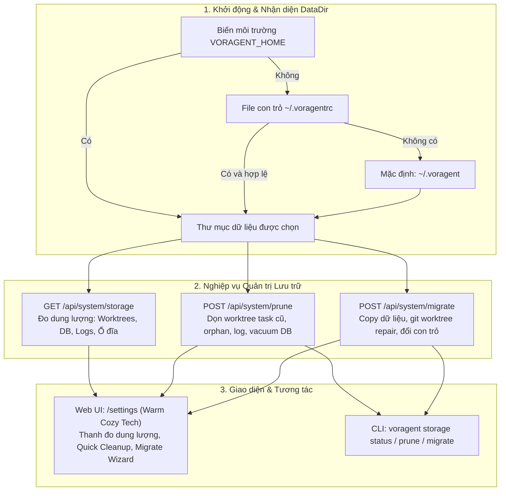

# Kế hoạch triển khai: Cài đặt vị trí dữ liệu .voragent, Migrate dữ liệu và Dọn dẹp rác

> **Mục tiêu:** Cung cấp tính năng toàn diện cho phép người dùng tùy chọn vị trí lưu trữ thư mục dữ liệu `.voragent` (tránh đầy ổ đĩa C hệ thống), di chuyển an toàn toàn bộ dữ liệu hiện có (kèm sửa chữa liên kết Git worktrees), đồng thời xây dựng trung tâm quản lý và dọn dẹp dung lượng thông minh (giải phóng worktrees task cũ, dọn orphan, xóa log, vacuum DB) trên cả Web UI (`/settings`) và CLI.

---

## 1. Phân tích hiện trạng & Kiến trúc giải pháp



---

## 2. Chi tiết các thành phần kỹ thuật

### A. Cơ chế Bootstrap Pointer (`~/.voragentrc`)
- Để không bắt người dùng Windows/macOS/Linux phải thiết lập thủ công biến môi trường hệ thống, ta dùng một file con trỏ JSON siêu nhẹ nằm ở `homedir()/.voragentrc`:
  ```json
  {
    "dataDir": "D:\\voragent_data"
  }
  ```
- **Thứ tự ưu tiên khi resolve data directory:**
  1. `process.env.VORAGENT_HOME` (nếu có và khác rỗng).
  2. `dataDir` trong `~/.voragentrc` (nếu file tồn tại và đường dẫn hợp lệ).
  3. Mặc định: `path.join(homedir(), '.voragent')`.

### B. Công cụ Di chuyển Dữ liệu (Data Migration Engine)
Khi người dùng yêu cầu chuyển vị trí từ `A` sang `B`:
1. **Kiểm tra tính hợp lệ:** Đảm bảo thư mục đích `B` có quyền ghi, không phải là thư mục con của `A`, và ổ đĩa đích còn đủ dung lượng trống (lớn hơn dung lượng của `A`).
2. **Khóa ghi / Checkpoint SQLite:** Chạy PRAGMA wal_checkpoint(TRUNCATE) để dồn toàn bộ WAL vào file DB chính trước khi sao chép.
3. **Sao chép dữ liệu:** Copy file cấu hình `config.json`, database `voragent.db`, log và toàn bộ thư mục `worktrees/`.
4. **Git Worktree Repair:**
   - Trong mỗi thư mục worktree con `worktrees/task-*`, cập nhật file text `.git` để trỏ đúng về repo gốc.
   - Chạy lệnh `git worktree repair` tại từng repo tương ứng để Git nhận diện lại vị trí mới mà không bị gãy tham chiếu.
5. **Cập nhật Bootstrap Pointer:** Ghi đường dẫn mới vào `~/.voragentrc`.
6. **Xác thực và dọn dẹp thư mục cũ:** Kiểm tra tính toàn vẹn của DB tại vị trí mới. Đổi tên thư mục cũ thành `...voragent.old` hoặc xóa theo lựa chọn của người dùng.

### C. Cơ chế Dọn dẹp Rác (Storage & Garbage Cleanup Engine)
1. **Phân loại và định lượng dung lượng:**
   - Quét và tính dung lượng theo 3 nhóm: `worktrees`, `database`, `logs`.
   - Lấy dung lượng còn trống của ổ đĩa hiện tại (sử dụng API hệ điều hành chuẩn).
2. **Giải phóng Worktree của Task đã kết thúc (Safe Prune):**
   - Với các task ở trạng thái `done`, `failed`, hoặc `cancelled`:
     - Giữ nguyên 100% bản ghi task trong SQLite Database (bao gồm metadata, hội thoại chat, turns, diff và checkpoints).
     - Xóa thư mục làm việc vật lý `worktrees/task-N` bằng `git worktree remove --force` và `rm -rf`.
     - Cập nhật trường `workspace_path = null` trong bảng `tasks` để đánh dấu thư mục đã được giải phóng.
3. **Dọn Worktrees mồ côi (Orphaned Worktrees):**
   - Quét các thư mục trong `worktrees/` không khớp với bất kỳ task nào trong cơ sở dữ liệu và dọn dẹp chúng.
4. **Thu gọn Log (Log Rotation / Truncate):**
   - Làm sạch hoặc cắt ngắn file `daemon.log` về 0 byte khi người dùng yêu cầu.
5. **Tối ưu hóa Database (SQLite VACUUM):**
   - Chạy lệnh SQL `VACUUM` để SQLite trả lại toàn bộ dung lượng đĩa chưa dùng về cho hệ điều hành.

### D. Giao diện Cài đặt (`/settings`) trên `@voragent/web`
- Tuân thủ nghiêm ngặt **DESIGN.md** (phong cách Warm Cozy Tech, tone màu kem ấm `#FFFDF8`, viền hổ phách mảnh `#F5E6D3`, font sans hiện đại).
- **Zero Double Scrollbars:** Áp dụng Unified Page Scroll, header dính (`position: sticky`), không cuộn lồng nhau.
- **Routing:** Đường dẫn chuẩn `/settings`, tự động bảo lưu `?key=...`. Có tab chuyển đổi trên thanh điều hướng chính cùng với Projects, Board, Office, Graph.
- **Tính năng UI:**
  - **Storage Breakdown:** Thanh đo dung lượng 3 màu phân biệt rõ ràng kèm thông tin ổ đĩa hiện tại.
  - **Quick Cleanup (1-Click):** Nút dọn dẹp nhanh kèm hiệu ứng SnakeLoader / Badge hiển thị số MB đã giải phóng.
  - **Migration Form:** Form chọn thư mục đích, hiển thị dung lượng trống của ổ đích và nút "Bắt đầu di chuyển" kèm thanh tiến trình.
